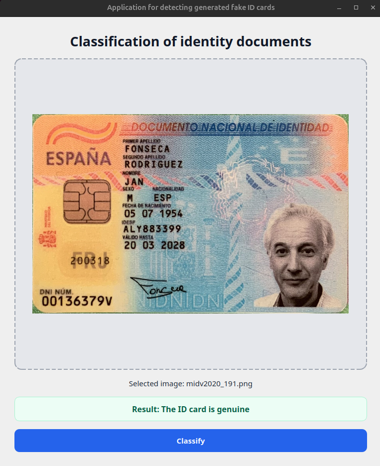
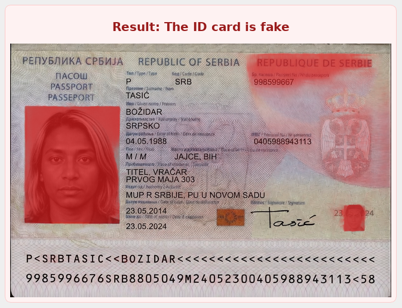
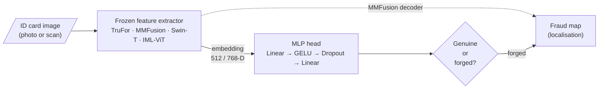

<div align="center">

# Detecting Generated Fake ID Cards

**Detecting digitally forged and AI-generated identity documents with vision-transformer
feature extractors and transfer learning.**

Bachelor's thesis, Brno University of Technology, Faculty of Information Technology (2026)

[](https://www.python.org/downloads/release/python-3120/)
[](https://pytorch.org/)
[](https://pypi.org/project/PyQt5/)
[](#requirements)
[](https://docs.astral.sh/ruff/)
[](https://mypy-lang.org/)
[](LICENSE)
[](checkpoint/LICENSE)

[Thesis](https://www.vut.cz/en/students/final-thesis/detail/169997) ·
[Usage manual](docs/USAGE.md) ·
[Licensing](LICENSING.md) ·
[Citation](#citation)

</div>

---

## Overview

Remote identity verification in banking, e-government and customer onboarding often relies only on
a **photo or scan of an identity document**. The physical security features of modern ID cards,
such as holograms, kinegrams, UV printing and laser engraving, cannot be checked from an image. In
addition, generative models (GANs, diffusion models, and image editing in ChatGPT or Gemini) can
now change the text fields or the holder's portrait so convincingly that a person cannot see the
difference.

This project is a **holistic detector** for such digital forgeries. Four pretrained
image-forensics architectures serve as **frozen feature extractors**, and a lightweight **MLP
classification head** trained on top of them decides whether a document is **genuine** or
**forged**. The best model is packaged in a **Linux desktop application** that also **localises**
the manipulated regions.

<table>
  <tr>
    <th align="center">Genuine document</th>
    <th align="center">Forged document with fraud map</th>
  </tr>
  <tr>
    <td align="center"></td>
    <td align="center"></td>
  </tr>
  <tr>
    <td align="center"><sub>The document is classified as genuine.</sub></td>
    <td align="center"><sub>The swapped portrait and the edited fields are highlighted in red.</sub></td>
  </tr>
</table>

<sub>The screenshots show fictional sample documents from the MIDV-2020 dataset.</sub>

## Highlights

- **High detection performance.** With MMFusion on the held-out test set, the model reached up to
  **99.04 % accuracy** and up to **99.56 % recall**, from different training configurations. In
  configuration B, which the application uses, only **2 of 453 forgeries were missed**.
- **Controlled comparison of four extractors.** TruFor, MMFusion, Swin Transformer and IML-ViT
  were each evaluated with the same data split, the same head and the same training setup.
- **Explainable output.** For forged documents, MMFusion's decoder produces a pixel-level
  **fraud map**, shown as a red overlay.
- **Desktop application.** The PyQt5 GUI runs inference in a background thread, so the window
  stays responsive.
- **Engineering quality.** The project has unit and integration tests (pytest), strict `mypy` type
  checking, `ruff` linting and a reproducible `make` workflow.
- **Tested on real documents.** The application correctly classified **12 of 13 real Czech ID
  cards**.

## Scope of the thesis

The thesis assignment covered five tasks:

1. Study the identity cards used in the Czech Republic, with a focus on their anti-counterfeiting
   features.
2. Study methods for creating synthetic identity cards (classic graphic techniques and generative
   models), and current machine-learning approaches for detecting such forgeries.
3. Design an algorithm for detecting forged identity cards, using either a morphological or a
   holistic approach.
4. Implement the algorithm in Python, together with a demonstration application for Linux.
5. Evaluate the detection accuracy experimentally, discuss the results and propose extensions.

This repository contains the implementation for tasks 3 to 5. The thesis text covers the analysis
of physical security features, the types of physical and digital forgery, and the related work.

## How it works



1. **Feature extraction (transfer learning).** The encoder of each pretrained forensic model turns
   the image into a feature map. Global average pooling reduces it to a single embedding.

   | Extractor | What is used | Embedding size |
   |---|---|:---:|
   | [TruFor](https://github.com/grip-unina/TruFor) | Noiseprint++ and a SegFormer (CMX) encoder, last stage | 512 |
   | [MMFusion](https://github.com/IDT-ITI/MMFusion-IML) | NoisePrint++, Bayar and SRM modalities with a dual-branch CMX encoder, last stage | 512 |
   | [Swin Transformer](https://github.com/microsoft/Swin-Transformer) | Swin-T `forward_features` | 768 |
   | [IML-ViT](https://github.com/SunnyHaze/IML-ViT) | Windowed ViT-B encoder, `last_feat` | 768 |

2. **Classification.** A two-layer MLP halves the embedding size, applies GELU and dropout (0.2 by
   default), and maps the result to the two classes. GELU was chosen to match the MLP blocks of
   all four extractors. Only this head is trained: the Adam optimiser and cross-entropy loss are
   combined with `ReduceLROnPlateau` and early stopping.
3. **Localisation (application only).** MMFusion's decode head combines all four encoder stages
   into a manipulation map, upsampled to the input resolution.

Because only a small head is trained, all four architectures can be compared under the same
conditions, and a good model can be trained without a very large dataset of identity documents.

## Results

### Dataset

The dataset has **5,542 images**: 2,546 genuine (45.9 %) and 2,996 forged (54.1 %). It combines
[FantasyID](https://www.idiap.ch/en/scientific-research/data/fantasyid) with the
[MIDV](https://doi.org/10.18287/2412-6179-co-1006) family (MIDV-500, MIDV-2020, MIDV-LAIT,
MIDV-HOLO, MIDV-UP). Additional forgeries were **created for this work with ChatGPT and Gemini**
on top of MIDV document templates.

| Forgery type | What was changed | Images |
|---|---|---:|
| `text_only` | Text fields only | 809 |
| `photo_only` | Holder's portrait only | 770 |
| `both` | Text and portrait | 1,417 |
| **Genuine** | — | **2,546** |

The data was split with a fixed seed into **75 % train, 10 % validation and 15 % test**,
stratified by label and attack type, so every extractor was evaluated on the same split.

The dataset itself is not published. GDPR constraints limited which real documents could be used,
and the generative tools increasingly refused to edit identity documents during data collection.

### Test-set performance (best configuration per extractor)

| Extractor | Accuracy | Precision | Recall | F1-score |
|---|:---:|:---:|:---:|:---:|
| TruFor | 55.98 % | 58.22 % | 66.45 % | 62.06 % |
| Swin Transformer | 94.02 % | 92.07 % | 97.35 % | 94.64 % |
| IML-ViT | 97.25 % | 97.15 % | 97.79 % | 97.47 % |
| **MMFusion** | **98.92 %** | **98.47 %** | **99.56 %** | **99.01 %** |

<sub>Forged documents are the positive class. The best MMFusion accuracy across configurations was
99.04 % (F1 99.12 %). The application uses configuration B because it has the highest recall: in
identity verification, a missed forgery costs more than a false alarm.</sub>

<details>
<summary><b>MMFusion confusion matrix (configuration B, test set)</b></summary>

| | Predicted genuine | Predicted forged |
|---|:---:|:---:|
| **Actually genuine** | 376 | 7 |
| **Actually forged** | 2 | 451 |

</details>

<details>
<summary><b>Training configurations</b></summary>

| Configuration | Learning rate | Batch size | Max epochs | Dropout | Purpose |
|---|:---:|:---:|:---:|:---:|---|
| A | 1 × 10⁻³ | 32 | 30 | 0.2 | Baseline |
| B | 5 × 10⁻⁴ | 32 | 30 | 0.2 | Slower learning |
| C | 1 × 10⁻³ | 32 | 30 | 0.3 | Stronger regularisation |

Early stopping ended every training run before the 30-epoch limit.

</details>

<details>
<summary><b>Reported results of existing models on FantasyID</b></summary>

These results come from the literature (Korshunov et al., IJCB 2025; Surendra Yeole et al., AAAI 2026) and were
measured on the FantasyID dataset. They are **not directly comparable** with the results above,
which come from a different dataset and include training on the target data.

| Model | Accuracy | F1-score |
|---|:---:|:---:|
| TruFor | 65.9 % | 80.7 % |
| MMFusion | 55.1 % | 73.7 % |
| UniFD | 50.0 % | 7.7 % |
| FatFormer | 48.8 % | 15.6 % |
| ResNet50 | 66.0 % | – |
| ViT-B16 | 72.0 % | – |
| Swin-T | 67.0 % | – |
| EfficientNet-B4 | 62.0 % | – |

</details>

### Discussion

- **MMFusion** benefits most from a task-specific head. Out of the box it reaches about 55 %
  accuracy on FantasyID; with the trained head it exceeds 99 % on this dataset.
- **TruFor** does poorly in this setup because only its last encoder stage is used, not its full
  detection pipeline with the confidence map.
- **Swin Transformer** and **IML-ViT** reach 94 % and 97 % accuracy, which shows that general and
  forensic vision transformers both produce useful embeddings for this task.

Chapter 5 of the thesis contains the loss curves and the full per-configuration analysis.

### Evaluation on real documents

As a final check, the application (MMFusion with configuration B) was run on **13 real Czech
identity cards** provided by volunteers. **12 of the 13** were correctly classified as genuine.
These images are not published, to protect the holders' personal data.

## Quick start

### Requirements

You need Linux, Python 3.12, GNU Make, git and an Internet connection. A CUDA GPU is optional.
See [the full list](docs/USAGE.md#requirements).

### Run the application

```bash
git clone https://github.com/MiroSatona/BP.git
cd BP
make build_app   # virtual environment, MMFusion and its weights
make run_app     # start the GUI
```

Click the preview area, select an image of an ID card, then click **Classify**.

### Train your own head

```bash
make build       # all four extractors and development tools

.venv/bin/python3.12 scripts/train.py \
    --extractor mmfusion --data_path /path/to/dataset \
    --batch_size 32 --epochs 30 --lr 5e-4 --device cuda
```

The [usage manual](docs/USAGE.md) covers all CLI options, the expected dataset layout, the
training outputs, the test commands and troubleshooting.

## Project structure

```text
.
├── checkpoint/              # trained MLP head used by the app (CC BY-NC-SA 4.0)
├── docs/                    # usage manual and screenshots
├── scripts/
│   ├── train.py             # training and evaluation CLI
│   ├── run_app.py           # GUI entry point
│   ├── build_app.py         # downloads MMFusion for the app
│   └── download_extractors.py
├── src/
│   ├── data_processing/     # dataset loading, stratified split, internal representation
│   ├── extractors/          # BaseExtractor and TruFor / MMFusion / Swin / IML-ViT wrappers
│   ├── heads/               # BaseHead and MLPHead
│   ├── model/               # Model (training pipeline) and AppModel (inference)
│   ├── training/            # metrics, history, logging, plots, checkpoints
│   └── gui/                 # PyQt5 window and background classification worker
├── tests/                   # pytest unit and integration tests
├── Makefile                 # build, run, test, lint and type-check targets
└── pyproject.toml
```

The extractors are downloaded into `external/` and are not tracked in Git.

## Limitations and responsible use

> [!WARNING]
> This is a **research prototype**, not a certified identity-verification system. Do not use it
> as the only basis for decisions about real people.

- The model detects **digital** manipulations in images. It does not check physical security
  features or presentation attacks (printed copies, documents shown on a screen).
- The training data is limited (about 5.5k images, mostly fictional templates). Accuracy on other
  document types, capture conditions or new generative tools may be lower.
- The real-world check used only 13 Czech ID cards.
- Because of the third-party licenses, the system may be used **for non-commercial purposes only**.
  See [LICENSING.md](LICENSING.md).

## Future work

- **A larger dataset.** About 5.5k images is still small for deep learning. More genuine samples
  and more types of generative forgery would improve how well the model generalises.
- **An end-to-end architecture.** With enough data, a single vision-transformer model could
  replace the separate feature extractor and classification head.

## Citation

If you use this work, please cite the thesis:

```bibtex
@thesis{zubek2026fakeid,
  author  = {Zůbek, Martin},
  title   = {Application for Detecting Generated Fake ID Cards},
  type    = {Bachelor's thesis},
  school  = {Brno University of Technology, Faculty of Information Technology},
  address = {Brno},
  year    = {2026},
  note    = {Supervisor: Ing. Tomáš Goldmann, Ph.D.},
  url     = {https://www.vut.cz/en/students/final-thesis/detail/169997}
}
```

Czech citation:

> ZŮBEK, Martin. *Aplikace pro detekci generovaných podvrhů občanských průkazů.* Brno, 2026.
> Bakalářská práce. Vysoké učení technické v Brně, Fakulta informačních technologií.
> Vedoucí práce Ing. Tomáš Goldmann, Ph.D.

GitHub also offers a ready-made citation through **Cite this repository**, based on
[`CITATION.cff`](CITATION.cff).

Please also cite the extractors and datasets you use: TruFor (Guillaro et al., CVPR 2023),
MMFusion (Triaridis & Mezaris, 2024), Swin Transformer (Liu et al., ICCV 2021), IML-ViT
(Ma et al., 2023), FantasyID (Korshunov et al., IJCB 2025) and MIDV-2020 (Bulatov et al., 2022).

## Acknowledgements

- **Ing. Tomáš Goldmann, Ph.D.**, thesis supervisor, for his guidance and advice.
- **[MetaCentrum](https://metavo.metacentrum.cz/)** for the computing resources used for the experiments.
- The authors of TruFor, MMFusion-IML, Swin Transformer and IML-ViT for releasing their code and
  weights, and the authors of the FantasyID and MIDV datasets.
- Everyone who provided real ID cards for testing.

<sub>As stated in the thesis, GitHub Copilot helped with code documentation, the GUI and the test
scaffolding, and ChatGPT helped with language editing of the thesis text. All generated code was
reviewed and adapted by the author.</sub>

## License

- **Source code**: [GNU AGPL v3.0 only](LICENSE), with an additional permission to combine it
  with TruFor and MMFusion.
- **Trained weights** (`checkpoint/`): [CC BY-NC-SA 4.0](checkpoint/LICENSE).
- **Third-party extractors and datasets**: their own licenses. TruFor and MMFusion are
  **non-commercial only**.

See [LICENSING.md](LICENSING.md) for details.

<div align="center"><sub>© 2026 Martin Zůbek · Brno University of Technology, Faculty of Information Technology</sub></div>
